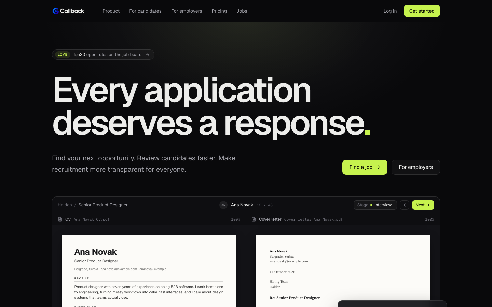
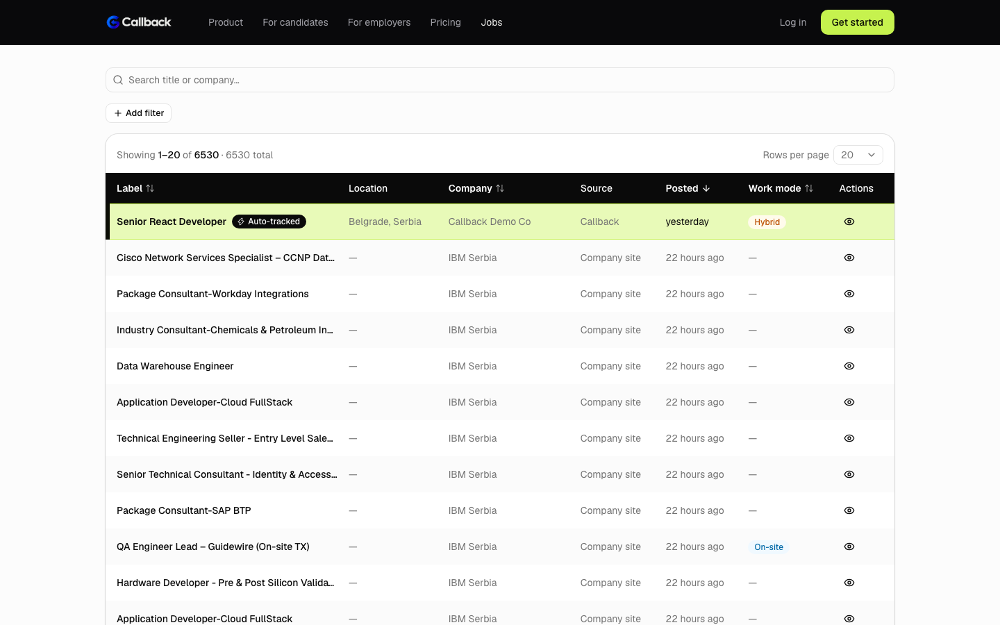
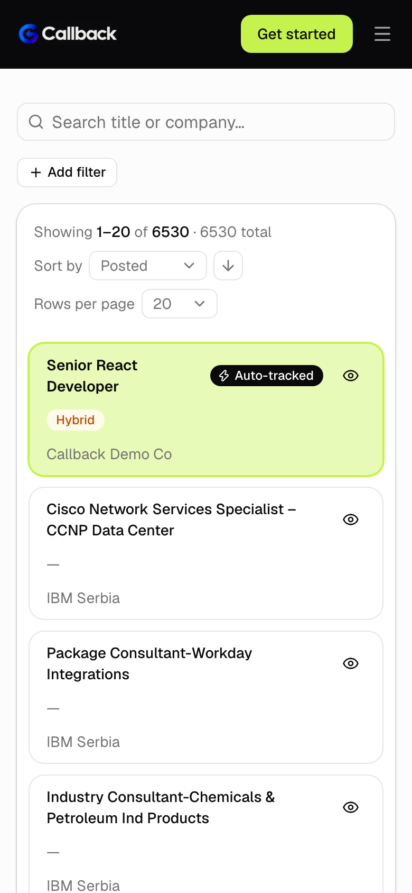
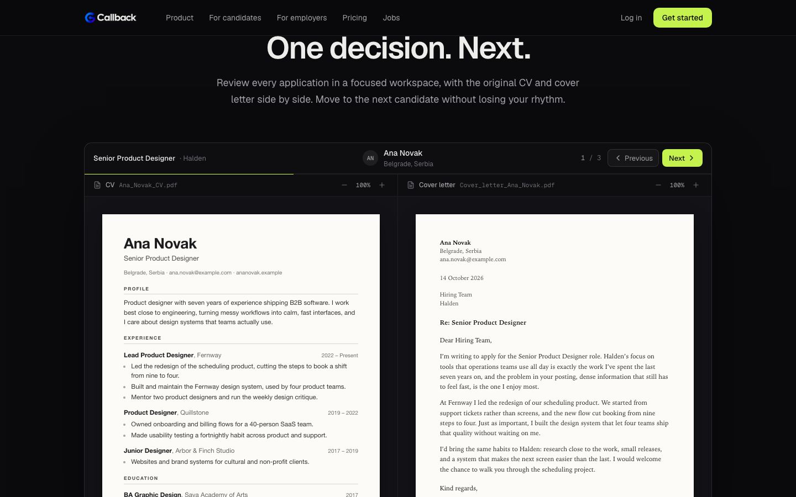
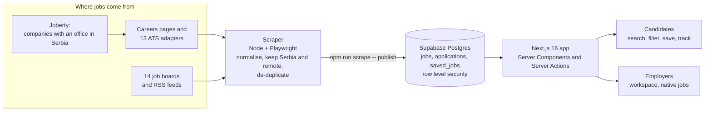

<div align="center">

<picture>
  <source media="(prefers-color-scheme: dark)" srcset="public/logo-on-dark.png">
  
</picture>

# Every application deserves a response.

**Callback** is a job board and application tracker for people looking for work in Serbia or remotely,
with a workspace for the companies that hire them.

<br>


[What it is](#-what-it-is) ·
[Screenshots](#-screenshots) ·
[Features](#-features) ·
[How it works](#-how-it-works) ·
[Getting started](#-getting-started) ·
[Security](#-security) ·
[Deployment](#-deployment) ·
[Docs](#-documentation) ·
[Roadmap](#-roadmap)

<br>



</div>

<br>

## 💡 What it is

Job hunting means a lot of tabs, a lot of applications and, far too often, no answer. Callback tackles both ends of that.

- **For candidates**, it gathers thousands of openings from company career pages and job boards into one fast, searchable list, and then helps you keep track of where every application stands.
- **For employers**, it is growing into a hiring workspace where jobs posted on Callback are tracked automatically, so candidates don't have to chase an answer.

| | Candidates | Employers |
|---|---|---|
| **Status** | ✅ Live in the app | 🚧 Early mock |
| **What you get** | Search 6,500+ open roles, filter them, save and track applications | A company workspace and a job form with a live candidate preview |
| **Coming next** | Automatic status updates for jobs posted on Callback | Saved job postings, a careers page, application forms, applicant review |

> The product vision (Smart Screening, Fast Manual Mode, automated candidate updates, a free plan) is on the landing page, clearly marked **Coming soon**. This README describes what is actually built.

<br>

## 🖼 Screenshots

<table>
  <tr>
    <td width="62%" align="center">
      
      <br><sub><b>The job list.</b> Jobs posted on Callback always come first, in lime, with an <i>Auto-tracked</i> badge.</sub>
    </td>
    <td width="38%" align="center">
      
      <br><sub><b>On a phone</b>, the table turns into cards.</sub>
    </td>
  </tr>
  <tr>
    <td colspan="2" align="center">
      
      <br><sub><b>Fast Manual Mode</b>, the planned employer review workspace, as an interactive demo on the landing page (fictional candidates).</sub>
    </td>
  </tr>
</table>

<sub>The highlighted job in the first screenshot is a fictional dev-only fixture. It never appears in a production build.</sub>

<br>

## ✨ Features

### 🔎 For candidates (live)

- **One list of open roles in Serbia and remote roles you can actually take.** Company career pages, 13 applicant-tracking systems and 14 job boards, de-duplicated, with the source credited on every row.
- **Instant search and a rule-based filter builder.** Combine rules on title, company, location, department, description, work mode, posted date and applied state, using *contains any / all / none* operators. Text matches whole words and ignores case and diacritics, so `cacak` finds Čačak. All of it runs in the browser, and the filters live in the URL, so a filtered view can be shared.
- **Work mode at a glance:** Remote, Hybrid or On-site badges, worked out from each posting.
- **Applied, one way on purpose.** Tick *Applied* and confirm. It can't be undone, and the database enforces that, not just the UI.
- **Track every application** on `/applications`, with a status you control: *Pending*, *Long time no answer*, *Rejected* or *Got offer*.
- **Saved jobs.** A heart on any row bookmarks it; saved jobs that the scraper later takes down stay listed as *Expired*.
- **Built for phones too.** The signed-in shell collapses to a top bar and tables turn into cards.

### 🏢 For employers (early)

- **Two account types**, chosen at sign-up, with separate sides of the app that redirect each other's users home.
- **A workspace under your company's slug** (`/your-company`), with a dashboard that offers to create your first job.
- **A job form with a live candidate preview.** Nothing is stored yet; this is the first step.
- **Jobs posted on Callback rank first in the list and are highlighted**, because Callback will be able to track their applications for the candidate, while for scraped jobs the candidate updates the status by hand. Until postings are stored, a single fictional fixture stands in for them in development.

### 🌐 Landing page

A dark marketing page with scroll reveals and CSS-only motion, a live count of open roles, and an interactive Fast Manual Mode demo, all without external fonts, scripts or images.

<br>

## 🧠 How it works



**The scraper** (`scraper/`) is a standalone TypeScript script, not part of the web app. It follows the path a person would: find companies, find each one's careers page or ATS (Greenhouse, Lever, Ashby, Workable, Workday and more), read the open positions, keep only those in Serbia or open to it remotely, and publish them to Supabase. A separate stage reads remote jobs from public job-board APIs. A posting that disappears is marked inactive, never deleted, so nobody's application history vanishes.

**The app** reads that job list on the server, caches it, and hands the browser the whole list to filter instantly. Descriptions load afterwards from their own endpoint, so the first paint doesn't wait for megabytes of text. There is **no Supabase client in the browser**: everything goes through Server Actions and Route Handlers, which is what lets the rate limits and validation hold.

<br>

## 🛠 Tech stack

| Layer | Choice |
|---|---|
| Framework | Next.js 16 (App Router, Turbopack, Cache Components, Partial Prerendering) |
| Language | TypeScript, React 19 |
| Styling & UI | Tailwind CSS v4, shadcn/ui on Base UI, Lucide icons, Geist |
| Data & auth | Supabase (Postgres, Row Level Security, Auth) |
| Validation | zod |
| Email | nodemailer over any SMTP server |
| Scraper | Node, `tsx`, Playwright, Cheerio |
| Hosting | One small VPS: Caddy, systemd, GitHub Actions |

<br>

## 🚀 Getting started

**You need** Node.js 20.9 or newer (CI and the server run 24) and a free [Supabase](https://supabase.com) project.

```bash
git clone git@github.com:milancakic89/callback.git
cd callback
npm install
cp .env.example .env.local     # then fill it in, see below
npm run dev                    # http://localhost:3000
```

### 1. Environment

Fill in `.env.local` (every variable is explained in [`.env.example`](.env.example)):

| Variable | What it is |
|---|---|
| `SUPABASE_URL`, `SUPABASE_PUBLISHABLE_KEY`, `SUPABASE_SECRET_KEY` | From your Supabase project's API settings. Server-only, never prefixed with `NEXT_PUBLIC_`. |
| `APP_URL` | The app's public address, used for links in emails (`http://localhost:3000` locally). |
| `SMTP_*`, `MAIL_FROM` | Any SMTP account, for the activation and password-reset emails. |
| `AUTH_COOKIE_SECRET` | 32+ characters: `openssl rand -hex 32`. |
| `REVALIDATE_SECRET` | Optional. Lets the scraper refresh the live job list at once. |

The app validates all of this at startup and tells you exactly what's missing.

### 2. Database

Run the SQL files in [`supabase/migrations/`](supabase/migrations) in order, for example by pasting each into the Supabase SQL editor. The Supabase side of auth is described in [`features/auth.md`](features/auth.md#manual-supabase-setup).

### 3. Fill it with jobs

```bash
npx playwright install chromium        # once
npm run scrape -- companies            # Joberty companies with an office in Serbia
npm run scrape -- careers              # find each company's careers page or ATS
npm run scrape -- jobs                 # collect the open positions
npm run scrape -- publish              # upsert them into Supabase
npm run scrape -- boards               # remote jobs from the job boards
```

`npm run jobs:refresh` runs the whole chain and is meant for cron. Every command is documented in [`features/job-scraper.md`](features/job-scraper.md).

### Everyday commands

```bash
npm run dev       # development server
npm run build     # production build (standalone output)
npm run lint      # ESLint
npm test          # unit tests (Vitest); `npm run test:watch` re-runs them as you edit
```

<br>

## 📁 Project structure

```text
src/
├─ app/
│  ├─ (app)/            candidate area: dashboard, saved-jobs, applications
│  ├─ (auth)/           sign-in, sign-up, forgot and reset password
│  ├─ (employer)/[company]/   employer workspace, one per company slug
│  ├─ jobs/             the public job list
│  ├─ auth/confirm/     email-link handler
│  └─ api/              job descriptions, cache refresh, health check
├─ components/          ui (shadcn), jobs, landing, dashboard, employer, auth
├─ lib/                 jobs (filter engine, queries), auth, supabase, rate limiting, mail
└─ proxy.ts             session refresh, route gating, global rate limit
scraper/                standalone job scraper: ats/, boards/, extract/, stages/
supabase/migrations/    the database, as SQL
features/               one spec per feature: decisions, constraints, verification
project-overview/       architecture, roadmap, security, deployment
deploy/                 Caddyfile, systemd unit and server scripts
.github/workflows/      the deploy pipeline
```

<br>

## 🔐 Security

Security is part of the design, not an afterthought. The full baseline is in [`project-overview/security.md`](project-overview/security.md).

- **Row Level Security everywhere.** Users can only read and write their own applications and saved jobs. Applying is irreversible at the database level (there is no delete grant), and only the `status` column can ever be updated.
- **No browser database client**, so every write passes through validated, rate-limited server code. Inputs are checked with zod, and server-only modules can't be imported into client code.
- **Rate limiting** on every request (per IP, in the proxy) and, backed by Postgres, on sign-in, sign-up, password reset, account choice, applying and saving.
- **Account enumeration is closed:** responses never reveal whether an email already has an account.
- **Account type lives in `app_metadata`**, which users can't edit, and every page and Server Action re-checks it instead of trusting the proxy.
- **A strict Content Security Policy**, HSTS, `nosniff`, frame denial and a locked-down Permissions Policy on every response.
- **URL filters are untrusted input:** capped, validated and regex-escaped, so a crafted link can't inject anything.

<br>

## 🌍 Deployment

Callback is built to run as **one Node process on a small VPS**, behind Caddy for automatic HTTPS. Its rate limit and cache live in the server's memory, so it isn't meant for serverless hosting.

A push to `main` triggers the GitHub Actions workflow, which lints and runs the tests first and, only if they pass, builds a standalone release, ships it over SSH, restarts the service, checks `/api/health` and **rolls back automatically** if the new release doesn't come up healthy. Everything needed, from ordering the server to the secrets to add, is in [`project-overview/deployment.md`](project-overview/deployment.md).

<br>

## 📚 Documentation

| | |
|---|---|
| [Architecture](project-overview/architecture.md) | Routes, layout, request pipeline, data model |
| [Security](project-overview/security.md) | The baseline and the rules for future code |
| [Deployment](project-overview/deployment.md) | Server, DNS, secrets and the pipeline |
| [Testing](project-overview/testing.md) | What the tests cover, what they don't, and how the deploy uses them |
| [Roadmap](project-overview/roadmap.md) | Phases, and what is deliberately deferred |
| [Job scraper](features/job-scraper.md) · [Job boards](features/job-boards.md) | Where the jobs come from |
| [Dashboard](features/dashboard.md) · [Applied](features/applied.md) · [Saved jobs](features/saved-jobs.md) | The candidate side |
| [Account types](features/account-types.md) · [Companies](features/companies.md) | The employer side |
| [Landing page](features/landing.md) · [Visual continuity](features/visual-continuity.md) | Design decisions |

Each feature doc records its **decisions, the constraints it ran into, and how it was verified**, including what was not.

<br>

## 🗺 Roadmap

- [x] Auth: sign-in, sign-up with email activation, password reset
- [x] Public job list with search, filters, sorting and paging
- [x] Job data: scraper for company career pages and ATS platforms, plus 14 job boards
- [x] Applications tracker with statuses, and saved jobs
- [x] Landing page
- [x] Two account types, and an employer workspace (first step, no storage yet)
- [x] Self-hosted deployment pipeline
- [ ] Employer: companies and job postings stored in the database
- [ ] Jobs posted on Callback, listed first and tracked automatically
- [ ] A public careers page per company, with its own branding
- [ ] Application forms with custom questions, and automatic status updates for the candidate
- [ ] Reviewing applicants: Fast Manual Mode and Smart Screening

<br>

<div align="center">

<sub>Built with Next.js, Supabase and a lot of care for the person on the other side of the application.</sub>

</div>
